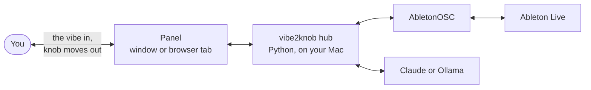

<p align="center">
  <picture>
    <source media="(prefers-color-scheme: dark)" srcset="https://raw.githubusercontent.com/thi-mb/vibe2knob/main/docs/media/banner-dark.png">
    
  </picture>
</p>

<p align="center">
  
  <a href="https://github.com/thi-mb/vibe2knob/blob/main/LICENSE"></a>
  
  
  
</p>

<p align="center">
  <a href="#quick-start"><b>Quick start</b></a> ·
  <a href="#using-it"><b>Using it</b></a> ·
  <a href="#how-it-works"><b>How it works</b></a> ·
  <a href="#roadmap"><b>Roadmap</b></a>
</p>

vibe2knob is a producer mate that sits next to Ableton Live. Say how a track should feel
("wider", "warmer", "the low end feels muddy") and it reads your set, then walks you through the
moves with Live's stock devices: which device, which knob, roughly where to set it, and why.
It teaches; it never touches your set.

https://github.com/user-attachments/assets/d3dd7c8f-d99a-4f13-8e09-6fe435dbef6a

- **It reads your set.** Through [AbletonOSC](https://github.com/ideoforms/AbletonOSC) it sees
  your tracks, their devices and parameter values, and which tracks play together in the
  arrangement.
- **It answers in knob moves.** Each step names a stock device and parameter with a target
  range, says why it works, and tells you what to listen for.
- **You stay in control.** Nothing in Live changes unless you change it.

> **Status: v0.2.** Mac only, Live 11 and 12 (tested on Live 11). Bring your own Claude API key,
> or run a model locally with Ollama. It's early, so expect rough edges and please open issues.

## Quick start

You need macOS, Live 11 or later, and [Homebrew](https://brew.sh). vibe2knob installs with
[pipx](https://pipx.pypa.io), which keeps it in its own environment. It needs Python 3.11 or
later, and Homebrew's pipx brings one.

1. **Install vibe2knob.** If you don't have pipx yet, install it first and open a new
   Terminal window afterwards:

   ```sh
   brew install pipx && pipx ensurepath
   ```

   Then:

   ```sh
   pipx install 'vibe2knob[window]'
   ```

2. **Connect it to Live.** vibe2knob reads Live through
   [AbletonOSC](https://github.com/ideoforms/AbletonOSC), a remote script. This copies it into
   Live's Remote Scripts folder:

   ```sh
   vibe2knob setup-live
   ```

   Then restart Live, open Settings > Link, Tempo & MIDI (Preferences in Live 11) and pick
   **AbletonOSC** as a Control Surface. `vibe2knob doctor` checks that it all works.
3. **Open the panel.**

   ```sh
   vibe2knob panel --window
   ```

   It opens in a slim window that stays on top of Live. Leave out `--window` to use a browser
   tab instead.
4. **Follow the setup card.** Paste a Claude API key (or pick Ollama), check that Live is
   connected, then select a track in Live and say how it should feel.

Want to look around first? `vibe2knob panel --window --fake` runs on example tracks with a
scripted model: no Live and no key.

To update, run `pipx upgrade vibe2knob`, then `vibe2knob setup-live` again in case AbletonOSC
changed. To run it from a git checkout instead, see
[docs/development.md](https://github.com/thi-mb/vibe2knob/blob/main/docs/development.md).

## Using it

- **Chats in tabs.** Each chat is one topic, like "Pad width" or "Low-end mud".
- **Context chips.** One chip follows the track you select in Live. Type `@` to pin more tracks
  to a chat. The model also gets a light summary of the whole set.
- **Step cards.** Each step shows the device, the parameter and a target range on a knob. Tap
  **Why?** for more, and read the **Listen** and **Caution** notes.
- **Follow-ups.** "Too much", "not enough" and "I made the changes" are one tap away. Every
  message re-reads your tracks, so the next answer starts from what you actually did.
- **Timing.** It knows which tracks play together and where, from the arrangement and its
  locators, so "the low end is muddy in the drop" means something.
- **Light and dark.** The panel follows your Mac's appearance, or you pick one in Settings.
- **Cost.** Each chat shows what it has cost so far, and Settings > Usage breaks it down by day,
  model and part of the prompt.

## Privacy and cost

- **Your key stays on your Mac.** It's kept in the Keychain (or read from `ANTHROPIC_API_KEY`) and
  only sent to Anthropic.
- **The model sees names and numbers, never audio.** Track names, devices, parameter values and
  clip positions. Nothing else leaves your machine.
- **No telemetry.** vibe2knob doesn't phone home.
- **You pay for your own usage.** The panel defaults to Claude Haiku 5.5, which is fast and
  cheap. Settings > Usage shows what you've spent. With Ollama it's free and fully offline.

## How it works



1. **The hub** owns the connection to Live, the model calls and your chats. The panel is a thin
   client that only shows things and sends what you type.
2. **The knowledge map.** [`terms.toml`](https://github.com/thi-mb/vibe2knob/blob/main/src/vibe2knob/knowledge/terms.toml) maps subjective
   words to techniques with stock devices, starting values and pitfalls. For example, "wide"
   leads to Utility width, chorus, a Haas delay and mid/side EQ, with "keep the sub mono".
3. **The check.** Steps are checked against your real device chain: stock devices only, and no
   "turn this knob" on a device that isn't there.

## Models

| Provider | Default model | Setup |
|---|---|---|
| Claude | `claude-haiku-5-5` in the panel | An API key from the [Claude Console](https://console.anthropic.com), pasted in Settings. |
| Ollama | `llama3.1` | Runs offline with [Ollama](https://ollama.com). Pick it in Settings. |

## Command line

The panel is the main way in, but there's more in the terminal:

```sh
vibe2knob doctor          # check Python, the panel, your key, AbletonOSC and Live
vibe2knob setup-live      # install or update AbletonOSC in Live
vibe2knob terms           # the words it knows
```

## Known limits

- Only regular tracks can be read, not returns or the master.
- Devices inside racks aren't listed, only the rack and its macros.
- A third-party plugin's knobs only show up after you add them with its Configure button in Live.
- AbletonOSC doesn't report when a clip ends, so clips are cut at the next clip on the track.

## Roadmap

- **v0.2:** Session view timing, a tool to ask what plays in a range of bars, tracks the model
  reads on its own, and `pipx install vibe2knob`.
- **v0.3:** speech input, and a Do mode that makes changes in Live for you, always shown,
  confirmed and undoable.
- **v0.4:** our own remote script in place of AbletonOSC, for exact timing and loading devices.
- **v0.5:** the panel on your phone.

More ideas are in [docs/future-ideas.md](https://github.com/thi-mb/vibe2knob/blob/main/docs/future-ideas.md).

## Contributing

The easiest and most useful contribution needs no code: improve
[`terms.toml`](https://github.com/thi-mb/vibe2knob/blob/main/src/vibe2knob/knowledge/terms.toml). Add a word people use, a better technique,
or a pitfall you learned the hard way, and add a case to [`evals/cases.toml`](https://github.com/thi-mb/vibe2knob/blob/main/evals/cases.toml)
that says what a good answer must do. For example, "make the bass wider" must keep the sub mono.

For code, see [docs/development.md](https://github.com/thi-mb/vibe2knob/blob/main/docs/development.md).

## License

Apache License 2.0. See [LICENSE](https://github.com/thi-mb/vibe2knob/blob/main/LICENSE).

vibe2knob is not affiliated with or endorsed by Ableton. Ableton and Live are trademarks of
Ableton AG.
